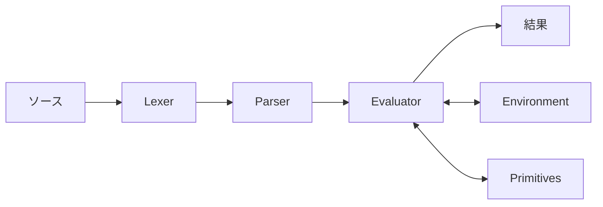

# Sucheme - RubyによるR5RS Schemeインタープリタ

[](https://github.com/suchi/sucheme-ruby/actions/workflows/ci.yml)

Sucheme（スキーム）は、純粋なRubyで実装されたR5RS準拠のSchemeインタープリタです。

## アーキテクチャ



## 特徴

- **R5RS準拠**: 標準的なScheme仕様に準拠
- **末尾呼び出し最適化**: トランポリニングによるTCO
- **完全な数値タワー**: 整数、有理数、浮動小数点
- **syntax-rules**: 省略記号付きマクロシステム
- **call/cc**: 継続（脱出継続）
- **REPL**: インタラクティブ環境
- **Web UI**: ブラウザベースの実行環境

## インストール

```bash
export PATH="$HOME/.local/share/gem/ruby/3.2.0/bin:$PATH"
bundle install --path vendor/bundle
```

## 使い方

```bash
# REPL起動
bundle exec ruby bin/sucheme

# ファイル実行
bundle exec ruby bin/sucheme samples/01_basics/variables.scm

# 式の評価
bundle exec ruby bin/sucheme -e '(+ 1 2 3)'

# Web UI
bundle exec ruby web/app.rb
```

## クイックスタート

```scheme
; 基本的な算術
(+ 1 2 3)      ;=> 6
(* 2 3 4)      ;=> 24

; 関数定義
(define (fact n)
  (if (= n 0) 1 (* n (fact (- n 1)))))
(fact 10)      ;=> 3628800

; 高階関数
(map (lambda (x) (* x x)) '(1 2 3 4 5))
;=> (1 4 9 16 25)

; マクロ
(define-syntax swap!
  (syntax-rules ()
    ((swap! a b)
     (let ((t a)) (set! a b) (set! b t)))))
```

## テスト

```bash
bundle exec rspec spec/ --format progress
```

## ライセンス

MIT
