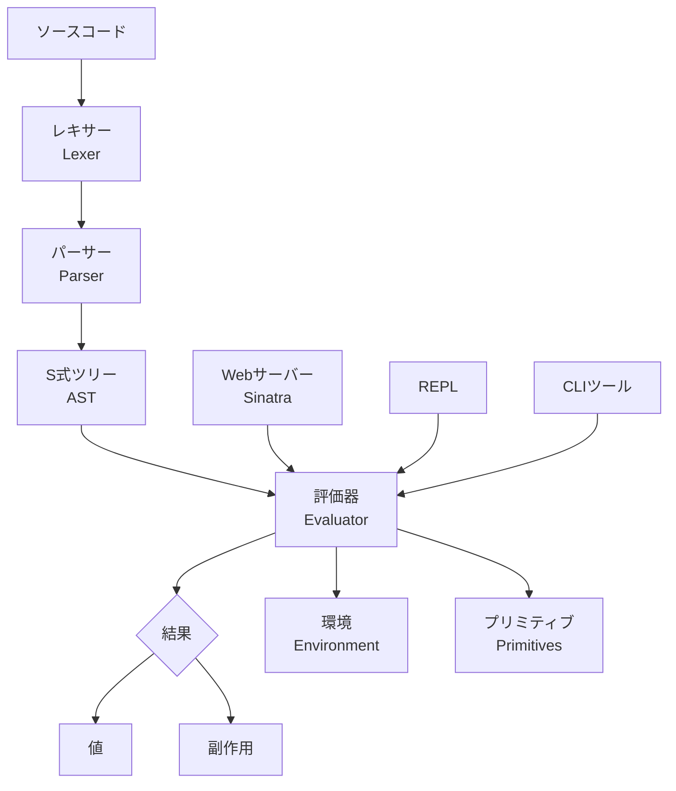

# Sucheme - 作業指示書 (Statement of Work)

## プロジェクト概要

Sucheme（スキーム）は、RubyでR5RS準拠のSchemeインタープリタを実装するプロジェクトです。

## アーキテクチャ



## データフロー

```mermaid
sequenceDiagram
    participant User
    participant REPL
    participant Lexer
    participant Parser
    participant Evaluator
    participant Environment

    User->>REPL: 入力 "(+ 1 2)"
    REPL->>Lexer: tokenize
    Lexer->>Parser: トークン列
    Parser->>Evaluator: S式ツリー
    Evaluator->>Environment: lookup "+"
    Environment->>Evaluator: SchemePrimitive
    Evaluator->>Evaluator: eval args [1, 2]
    Evaluator->>REPL: 3
    REPL->>User: ";; => 3"
```

## 成果物

| ファイル | 説明 |
|---------|------|
| `lib/sucheme/lexer.rb` | トークン化 |
| `lib/sucheme/parser.rb` | S式解析 |
| `lib/sucheme/evaluator.rb` | 評価器（TCO付き） |
| `lib/sucheme/primitives.rb` | 組み込み関数 |
| `lib/sucheme/environment.rb` | 環境管理 |
| `lib/sucheme/types.rb` | Scheme型定義 |
| `web/app.rb` | Web UI |
| `bin/sucheme` | CLIツール |

## 品質基準

- R5RS準拠テスト: 全パス
- 末尾呼び出し最適化: 100万回のループ
- コードカバレッジ: 80%以上
